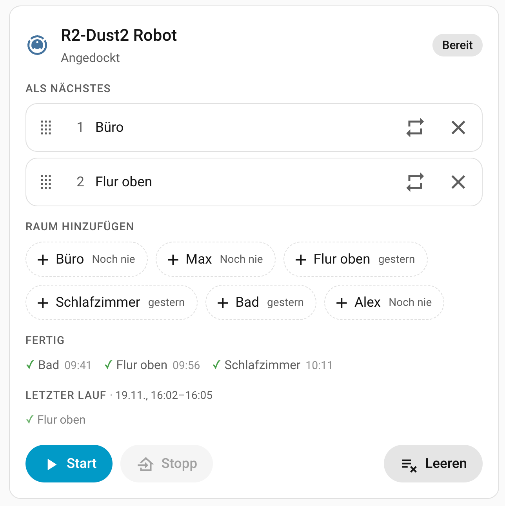

<p align="center">
  
</p>

# Vacuum Room Queue

[](https://hacs.xyz/docs/marketplace/)
[](https://github.com/olli-dot-dev/ha-vacuum-room-queue/releases)


[English](README.md) · **Deutsch**

Home-Assistant-Integration mit eigener Dashboard-Karte: Du legst per **Drag & Drop**
fest, in welcher Reihenfolge dein Saugroboter die Räume abfährt – und kannst die
Reihenfolge **jederzeit ändern, Räume entfernen oder ergänzen, auch während er
schon fährt**.

Änderungen je Version: siehe [CHANGELOG.md](CHANGELOG.md).

<p align="center">
  
</p>

## Wie es funktioniert

Die Integration gibt dem Roboter **immer nur einen Raum**. Meldet er, dass er damit
fertig ist (er wechselt von `cleaning` auf `returning`, `docked` oder `idle`), schickt
sie sofort den nächsten Raum der Raumreihenfolge – der Roboter fährt also direkt
weiter, statt erst zur Station. Weil die Raumreihenfolge in Home Assistant liegt und
nicht im Roboter, wirkt jede Änderung ab dem nächsten Raum.

- **Räume mehrfach:** Ein Raum darf beliebig oft in der Raumreihenfolge stehen,
  direkt hintereinander oder später noch einmal; er wird dann entsprechend oft
  gereinigt.
- **Raum, der gerade gesaugt wird:** lässt sich überspringen (⏭ oder ✕); dann geht's
  sofort mit dem nächsten Raum weiter bzw. zurück zur Station.
- **Pause / Fortsetzen** gehen über die Karte, die Hersteller-App oder den Roboter
  selbst – die Integration folgt dem Zustand des Roboters.
- **Stopp** über die Karte schickt den Roboter zur Station; der aktuelle Raum kommt
  zurück an den Anfang der Raumreihenfolge. Was bei einem Stopp an anderer Stelle
  passiert, steht unter [Stoppen](#stoppen).
- **Fehler:** Meldet der Roboter einen Fehler oder fängt er nach dem Befehl nicht an zu
  saugen (Standard: 10 Minuten, in den Optionen einstellbar – Stationen, die erst die
  Mopps waschen, brauchen ein paar Minuten), zeigt die Karte das an; „Erneut
  versuchen“ schickt denselben Raum noch einmal. Fängt der Roboter doch noch an,
  verschwindet der Fehler von selbst.
- Kurze Verbindungsabbrüche des Roboters (`unavailable`/`unknown`) werden ignoriert;
  erst der nächste echte Zustand zählt.
- Die Raumreihenfolge übersteht einen Neustart von Home Assistant.

### Stoppen

| Wie | Ergebnis |
| --- | --- |
| Karte: **Stopp** | ✅ Roboter fährt heim, aktueller Raum zurück an den Anfang |
| Hersteller-App: erst **Pause**, dann **zur Station** | ✅ Lauf beendet, Raum bleibt in der Raumreihenfolge |
| Home Assistant: Kachel, Automation, Sprachassistent (`vacuum.stop`, `vacuum.return_to_base`) | ✅ wie Stopp in der Karte |
| Hersteller-App: **Stopp** oder **zur Station**, während er saugt | ⚠️ sieht aus wie „Raum fertig“ – der nächste Raum wird losgeschickt |

Den letzten Fall kann Home Assistant nicht erkennen: Der Roboter meldet genau das,
was er auch nach einem fertigen Raum meldet. Willst du in der App abbrechen, pausiere
erst und schick ihn dann zur Station – oder leere vorher die Raumreihenfolge.

## Voraussetzungen

- Home Assistant **2026.10** oder neuer
- Ein Saugroboter, der entweder
  - **native Bereichsreinigung** kann (`vacuum.clean_area`, z. B. viele Roborock-,
    Dreame-, Ecovacs-Integrationen in aktuellen Versionen) – dann einmal am Roboter
    die Segmente den Home-Assistant-Bereichen zuordnen
    (*Saugroboter-Entität → Einstellungen → Bereiche zuordnen*), oder
  - sich per **Skript** in einen einzelnen Raum schicken lässt (siehe unten).

**Getestet** mit einem Dreame-Roboter mit Wisch-Station über **Valetudo** (MQTT, native
Bereichsreinigung), Home Assistant 2026.11:

- Vor dem ersten Raum wäscht die Station knapp **3 Minuten** die Mopps; erst dann meldet
  der Roboter `cleaning`. Deshalb wartet die Integration standardmäßig 10 Minuten,
  bevor sie „hat nicht angefangen“ meldet (einstellbar).
- Raumwechsel – auch derselbe Raum zweimal hintereinander – nach rund **8 Sekunden**,
  ohne Umweg über die Station.
- Valetudo meldet beim nächsten Raum kurz `idle` und bei „Stopp“ erst `idle`, dann
  `returning`; beides fängt die Integration ab.

## Installation

### Marketplace (ab Home Assistant 2026.11)

Seit 2026.11 ist HACS als **Marketplace** fest in Home Assistant eingebaut.

[](https://my.home-assistant.io/redirect/marketplace_repository/?owner=olli-dot-dev&repository=https%3A%2F%2Fgithub.com%2Folli-dot-dev%2Fha-vacuum-room-queue)

Auf den Button klicken oder das Repository von Hand hinzufügen:

1. **Einstellungen → Marketplace** öffnen
2. **Über Link hinzufügen** wählen und `https://github.com/olli-dot-dev/ha-vacuum-room-queue` einfügen
3. **Vacuum Room Queue** öffnen und **Installieren** wählen

Ein Neustart ist meist nicht nötig; fordert Home Assistant ihn unter
**Einstellungen → System → Reparaturen** an, einmal neu starten.

Unter Home Assistant 2026.10 mit HACS: **HACS → ⋮ → Benutzerdefinierte Repositories**,
den Link oben mit Kategorie **Integration** hinzufügen, herunterladen, neu starten.

### Manuell

`custom_components/vacuum_room_queue` in dein `config`-Verzeichnis kopieren und neu
starten.

Die Karte musst du nicht separat installieren: Die Integration liefert sie selbst aus
und trägt sie automatisch als Dashboard-Ressource ein.
Zeigt das Dashboard direkt nach der Einrichtung „Konfigurationsfehler“, lade die
Browserseite (bzw. die App) einmal neu.

## Einrichtung

**Einstellungen → Geräte & Dienste → Integration hinzufügen → Vacuum Room Queue**

1. Saugroboter wählen
2. Räume: Kann der Roboter einzelne Bereiche selbst anfahren (native
   Bereichsreinigung), kannst du die Räume optional einschränken und sortieren (leer =
   alle zugeordneten Bereiche). Kann er das nicht, wählst du ein Skript und die Räume
   (siehe [Skript-Methode](#skript-methode)).

Die Methode wählt die Einrichtung selbst; in den Optionen der Integration lässt sie
sich später ändern.

Pro Saugroboter entsteht ein Sensor `sensor.<roboter>_raumreihenfolge` mit dem Status
(`idle`, `running`, `paused`, `error`). Name und Entitäts-ID folgen den Regeln von Home
Assistant: Der Name steht in deiner Sprache, die Entitäts-ID in der Systemsprache, sofern
sie lateinische Schrift nutzt (auf Englisch z. B. `sensor.<roboter>_room_queue`), sonst
auf Englisch (z. B. bei Russisch).
Attribute:

| Attribut | Inhalt |
| --- | --- |
| `current_area` | Raum, der gerade dran ist |
| `queue` | wartende Räume (Bereichs-IDs, Wiederholungen möglich) |
| `done` | erledigte Räume dieses Laufs |
| `history` | dieser und der letzte Lauf mit Start- und Fertig-Zeiten |
| `last_cleaned` | je Bereich, wann er zuletzt über die Integration fertig wurde |
| `rooms` | Räume, die sich hinzufügen lassen |
| `rooms_hint` | warum keine Räume da sind (`no_mapping`, `no_rooms`) oder leer |
| `error` | `vacuum_error`, `did_not_start`, `command_failed` oder leer |
| `vacuum_entity_id` | der Saugroboter |

### Optionen

*Vacuum Room Queue → Konfigurieren*: Methode (direkt oder Skript), die angebotenen
Räume und die **Wartezeit bis zum Start** (1–60 Minuten, Standard 10). Stationen, die
vor dem Losfahren die Mopps waschen oder trocknen, brauchen dafür einige Minuten.

### Räume noch nicht zugeordnet?

Für die native Bereichsreinigung muss der Roboter wissen, welches seiner Segmente zu
welchem Home-Assistant-Bereich gehört. Fehlt diese Zuordnung, legt die Einrichtung
keinen leeren Eintrag an, sondern zeigt, was zu tun ist. Ordne die Segmente zu und
wähle dann „Erneut prüfen“, oder nimm stattdessen die Skript-Methode.

**Die Segmente haben nur Nummern** („1“, „2“, „Room 3“ …)? Das passiert, wenn die Räume
in der App des Roboters noch keine Namen haben, z. B. bei **Valetudo**. Im
Zuordnungsdialog von Home Assistant siehst du dann nur diese Nummern und keine Karte.
Benenne die Räume deshalb zuerst in der App, bei Valetudo in der Weboberfläche unter
*Karte → Segmente bearbeiten*. Danach tauchen die Namen beim Zuordnen auf.

Geht die Zuordnung später verloren, z. B. weil die Karte im Roboter neu angelegt wurde,
zeigt die Karte statt der Räume einen Hinweis mit einem Knopf zum Saugroboter.

## Karte

1. Dashboard → ✏️ **Bearbeiten** → im Abschnitt auf **+**
2. Oben den Reiter **„Nach Karte“** wählen – unter „Nach Entität“ wird die Karte nicht
   vorgeschlagen – und nach **„Vacuum Room“** suchen
3. **Vacuum Room Queue** antippen: Die Raumreihenfolge ist schon ausgewählt (bei mehreren
   Saugrobotern hier den richtigen wählen), der Titel ist optional, rechts siehst du die
   Karte live → **Speichern**

Oder per YAML:

```yaml
type: custom:vacuum-room-queue-card
entity: sensor.robi_raumreihenfolge
title: Saugen   # optional
```

- Räume unter „Raum hinzufügen“ antippen → kommen ans Ende der Raumreihenfolge. Bei
  jedem Raum steht, wann er zuletzt gereinigt wurde („gestern“, „vor 3 Wochen“; die genaue
  Zeit als Tooltip). Es zählen nur Räume, die über die Integration fertig wurden – keine
  übersprungenen und keine Reinigungen aus der Hersteller-App (Stufen siehe
  [Zuletzt gereinigt](#zuletzt-gereinigt))
- Am Griff ⠿ ziehen → Reihenfolge ändern (Maus und Touch); alternativ Griff
  fokussieren und Pfeiltasten ↑/↓
- ↻ (Nochmal) setzt denselben Raum direkt dahinter noch einmal in die Raumreihenfolge –
  auch beim Raum, der gerade gereinigt wird. So lässt sich ein Raum mehrfach saugen
  oder wischen; ob gesaugt oder gewischt wird, stellst du am Roboter ein
- ✕ entfernt diesen einen Eintrag
- Unter **Fertig** stehen die Räume dieses Laufs mit Uhrzeit, darunter klein der
  **letzte Lauf**. Ein neuer Lauf beginnt mit Start aus dem Ruhezustand oder mit
  „Leeren“, wenn gerade nichts läuft.

### Zuletzt gereinigt

Den Wortlaut liefert der Browser in der Sprache des Benutzerprofils:

| Alter | Anzeige |
| --- | --- |
| unter 1 Minute | „jetzt“ |
| 1–59 Minuten | „vor 1 Min.“ … „vor 59 Min.“ |
| ab 1 Stunde, solange es **heute** war oder weniger als 12 Stunden her ist | „vor 1 Std.“ … „vor 23 Std.“ (gerundet: ab 90 Minuten „vor 2 Std.“) |
| sonst nach **Kalendertagen**, bis 13 | „gestern“, „vorgestern“, „vor 3 Tagen“ … „vor 13 Tagen“ |
| 14–59 Tage | „vor 2 Wochen“ … „vor 8 Wochen“ (gerundet: 14–17 Tage = 2, 18–24 = 3 …) |
| ab 60 Tagen | „vor 2 Monaten“, „vor 3 Monaten“ … (Tage ÷ 30, gerundet; keine Jahre) |

Die 12-Stunden-Regel sorgt dafür, dass eine Reinigung um 23:00 Uhr nicht schon um
1:00 Uhr nachts als „gestern“ erscheint (dort steht „vor 2 Std.“). Raum noch nie über
die Integration fertig geworden: „Noch nie“.

## Dienste

Alle Dienste nehmen als `entity_id` den Sensor **oder** den Saugroboter.

| Dienst | Wirkung |
| --- | --- |
| `vacuum_room_queue.set_queue` | Wartende Räume ersetzen (`areas`: Liste von Bereichs-IDs, Wiederholungen erlaubt) |
| `vacuum_room_queue.add_area` | Raum hinzufügen, auch ein weiteres Mal (`area_id`, optional `position`, 0 = als Nächstes) |
| `vacuum_room_queue.remove_area` | Mit `position` nur diesen Eintrag entfernen, sonst alle Einträge des Raums (und ihn überspringen, falls er gerade dran ist) |
| `vacuum_room_queue.start` | Starten, fortsetzen oder nach Fehler erneut versuchen; optional `areas` |
| `vacuum_room_queue.pause` | Pausieren |
| `vacuum_room_queue.skip` | Aktuellen Raum überspringen |
| `vacuum_room_queue.stop` | Zur Station; aktueller Raum zurück an den Anfang der Raumreihenfolge |
| `vacuum_room_queue.clear` | Alle wartenden Räume entfernen |

Beispiel-Automation „Wenn alle weg sind: Küche zweimal, dann Flur“:

```yaml
action: vacuum_room_queue.start
data:
  entity_id: vacuum.robi
  areas: [kuche, kuche, flur]
```

## Skript-Methode

Für Roboter ohne native Bereichsreinigung. Das Skript wird pro Raum einmal mit den
Variablen `area_id`, `area_name` und `vacuum_entity_id` gestartet und muss den Roboter
in **genau diesen einen Raum** schicken. Beispiel für einen Roborock über die
Segment-IDs:

```yaml
script:
  sauge_raum:
    alias: Einen Raum saugen
    fields:
      area_id: {}
      vacuum_entity_id: {}
    variables:
      segmente:
        kuche: 16
        wohnzimmer: 17
        flur: 18
    sequence:
      - action: vacuum.send_command
        target:
          entity_id: "{{ vacuum_entity_id }}"
        data:
          command: app_segment_clean
          params:
            - segments: "{{ [segmente[area_id]] }}"
              repeat: 1
```

## Grenzen

- Die Integration erkennt „Raum fertig“ am Zustandswechsel des Roboters. Meldet ein
  Roboter zwischen zwei Räumen keinen eigenen Zustand (bleibt also durchgehend auf
  `cleaning`), kann sie das Ende eines Raums nicht sehen – bei Robotern, die nur einen
  Raum pro Befehl bekommen, ist das aber praktisch immer der Fall.
- Stopp oder Heimfahrt **aus der Hersteller-App** während der Fahrt hält die
  Integration für „Raum fertig“ (siehe [Stoppen](#stoppen)).
- Noch nicht am echten Roboter geprüft: große Räume, in denen der Roboter
  **mittendrin zum Mopp-Waschen** zur Station fährt. Meldet er dabei `returning` oder
  `docked`, würde die Integration den Raum für fertig halten und den nächsten
  schicken.
- Saugstufe, Wischen usw. stellst du weiterhin am Roboter bzw. über dessen Entitäten
  ein; die Integration kümmert sich nur um die Reihenfolge.

## Sprachen

Englisch, Deutsch, Niederländisch, Französisch, Spanisch, Polnisch und Russisch – für
Einrichtung, Optionen, Dienste und Meldungen (`translations/`) ebenso wie für die
Karte (`card_translations/`). Die Karte folgt der Sprache im Profil; für andere
Sprachen erscheint sie auf Englisch.

Eine neue Sprache braucht zwei Dateien: `translations/<sprache>.json` (Vorlage:
`strings.json`) und `card_translations/<sprache>.json` (Vorlage: `en.json`). Ein Test
prüft, dass jede Sprache alle Texte und dieselben Platzhalter hat. Korrekturen und neue
Sprachen gern als Pull Request.

## Entwicklung

```bash
uv sync
uv run pytest
uv run ruff check . && uv run mypy
```

- `dev/index.html` – die Karte ohne Home Assistant ausprobieren (Repo-Wurzel per
  `python3 -m http.server` ausliefern, dann `/dev/index.html` öffnen); ein Fake-`hass`
  spielt die Dienste nach, inkl. einem Beispiel-Lauf von gestern für die Historie.
  Mit `?lang=fr` usw. lässt sich jede Sprache der Karte ansehen.
- `dev/brand/` – Quelle des Integrations-Icons (`icon.svg`); `render.py` erzeugt daraus
  `brand/icon.png` und `icon@2x.png` (braucht Playwright).
- `dev/fake_vacuum/` – ein Fake-Saugroboter mit Bereichsreinigung für eine
  Test-Instanz (`vacuum: [{platform: fake_vacuum}]`), 20 s pro Raum. Wird nicht mit
  ausgeliefert.

## Danke

Die Idee zu dieser Integration stammt von Dominik (ich hoffe, ich habe den Namen
richtig in Erinnerung), der sie mir auf dem **Home Assistant Community Day 2026**
vorgestellt hat. Ohne ihn gäbe es Vacuum Room Queue nicht – vielen Dank dafür!
Dominik, falls du das liest: Melde dich sehr gerne bei mir, einfach per Issue oder
Nachricht.
