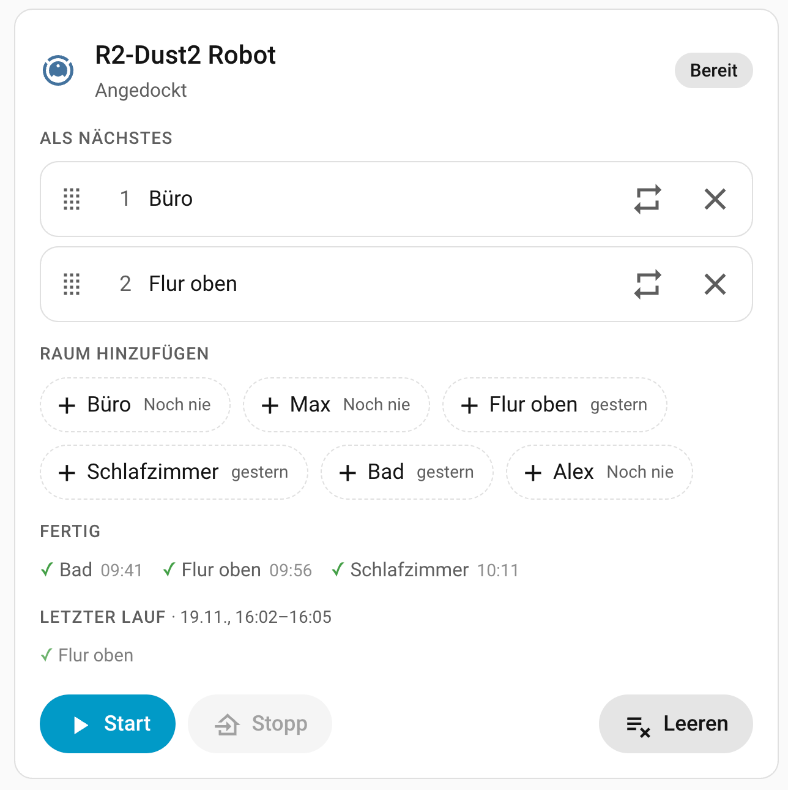

<p align="center">
  
</p>

# Vacuum Room Queue

[](https://hacs.xyz/docs/marketplace/)
[](https://github.com/olli-dot-dev/ha-vacuum-room-queue/releases)


**English** · [Deutsch](README.de.md)

A Home Assistant integration with its own dashboard card: set the order in which your
robot vacuum cleans the rooms by **drag & drop** – and **change it at any time, remove
or add rooms, even while it is already cleaning**.

See [CHANGELOG.md](CHANGELOG.md) for release notes.

<p align="center">
  
</p>

## How it works

The integration gives the vacuum **one room at a time**. As soon as the vacuum reports
that it is done with it (it changes from `cleaning` to `returning`, `docked` or `idle`),
the next room of the queue is sent – so the vacuum drives straight on instead of going
back to its dock first. Because the queue lives in Home Assistant and not in the
vacuum, every change takes effect from the next room on.

- **Rooms more than once:** a room may be in the queue any number of times, right after
  each other or later again; it is cleaned that many times.
- **The room being cleaned** can be skipped (⏭ or ✕); the vacuum goes on with the next
  room right away, or back to its dock.
- **Pause / resume** work from the card, the vendor app or the vacuum itself – the
  integration follows the vacuum's state.
- **Stop** in the card sends the vacuum home; the current room goes back to the front
  of the queue. What happens on a stop from elsewhere: see [Stopping](#stopping).
- **Errors:** if the vacuum reports an error or does not start cleaning after the
  command (default: 10 minutes, configurable in the options – docks that wash the mops
  first need a few minutes), the card shows it; "Retry" sends the same room again. If
  the vacuum does start after all, the error goes away by itself.
- Short dropouts of the vacuum (`unavailable`/`unknown`) are ignored; only its next real
  state counts.
- The queue survives a restart of Home Assistant.

### Stopping

| How | Result |
| --- | --- |
| Card: **Stop** | ✅ vacuum goes home, current room back to the front |
| Vendor app: **pause** first, then **dock** | ✅ run ends, room stays in the queue |
| Home Assistant: tile card, automation, voice (`vacuum.stop`, `vacuum.return_to_base`) | ✅ same as Stop in the card |
| Vendor app: **stop** or **dock** while it is cleaning | ⚠️ looks like "room done" – the next room is sent |

Home Assistant can't tell the last case apart: the vacuum reports exactly what it
reports after a finished room. To cancel from the app, pause first and then send it
home – or clear the queue beforehand.

## Requirements

- Home Assistant **2026.10** or newer
- A robot vacuum that either
  - supports **native area cleaning** (`vacuum.clean_area`, e.g. many Roborock, Dreame
    and Ecovacs integrations in current versions) – then map its segments to Home
    Assistant areas once (*vacuum entity → settings → map areas to segments*), or
  - can be sent to a single room by a **script** (see below).

**Tested** with a Eureka vacuum with mop-washing dock via **Valetudo** (MQTT, native
area cleaning), Home Assistant 2026.11:

- Before the first room the dock washes the mops for almost **3 minutes**; only then
  does the vacuum report `cleaning`. That's why the integration waits 10 minutes by
  default before it reports "did not start" (configurable).
- Changing rooms – including the same room twice in a row – after about **8 seconds**,
  without a detour to the dock.
- Valetudo briefly reports `idle` on the next room, and `idle` then `returning` on
  "stop"; the integration handles both.

## Installation

### Marketplace (Home Assistant 2026.11 and newer)

Since 2026.11, HACS is built into Home Assistant as the **Marketplace**.

[](https://my.home-assistant.io/redirect/marketplace_repository/?owner=olli-dot-dev&repository=ha-vacuum-room-queue&category=integration)

Click the badge above, or add the repository by hand:

1. Go to **Settings → Marketplace**
2. Choose **Add from link** and paste `https://github.com/olli-dot-dev/ha-vacuum-room-queue`
3. Open **Vacuum Room Queue** and click **Install**

Usually no restart is needed; if Home Assistant asks for one under
**Settings → System → Repairs**, restart once.

On Home Assistant 2026.10 with HACS: **HACS → ⋮ → Custom repositories**, add the link
above with category **Integration**, download, restart.

### Manual

Copy `custom_components/vacuum_room_queue` into your `config` directory and restart.

You don't need to install the card separately: the integration serves it and adds it
as a dashboard resource automatically. If the dashboard shows "Configuration error"
right after the setup, reload the browser page (or the app) once.

## Setup

**Settings → Devices & services → Add integration → Vacuum Room Queue**

1. Choose the vacuum
2. Rooms: if the vacuum can go to single areas by itself (native area cleaning), you can
   optionally limit and order the rooms (empty = all mapped areas). If it can't, you
   choose a script and the rooms (see [Script method](#script-method)).

The setup picks the method itself; it can be changed later in the integration's
options.

Each vacuum gets a sensor `sensor.<vacuum>_room_queue` with the status (`idle`,
`running`, `paused`, `error`). Name and entity ID follow Home Assistant's own rules: the
name is in your language, the entity ID in the system language for languages with Latin
script (e.g. `sensor.<vacuum>_raumreihenfolge` in German) and in English otherwise (e.g.
Russian). Attributes:

| Attribute | Content |
| --- | --- |
| `current_area` | room being cleaned |
| `queue` | waiting rooms (area IDs, repeats possible) |
| `done` | rooms finished in this run |
| `history` | this run and the previous one, with start and finish times |
| `last_cleaned` | per area the time it was last finished by the integration |
| `rooms` | rooms that can be added |
| `rooms_hint` | why there are no rooms (`no_mapping`, `no_rooms`), or empty |
| `error` | `vacuum_error`, `did_not_start`, `command_failed`, or empty |
| `vacuum_entity_id` | the vacuum |

### Options

*Vacuum Room Queue → Configure*: method (directly or script), the rooms offered and the
**wait for the start** (1–60 minutes, default 10). Docks that wash or dry the mops
before the vacuum leaves need a few minutes for that.

### Rooms not mapped yet?

For native area cleaning the vacuum has to know which of its segments belongs to which
Home Assistant area. If that mapping is missing, the setup doesn't create an empty
entry but shows what to do. Map the segments and choose "Check again", or use the
script method instead.

**The segments only have numbers** ("1", "2", "Room 3" …)? That happens when the rooms
have no names in the vacuum's app yet, e.g. with **Valetudo**. Home Assistant's mapping
dialog then shows only these numbers and no map. So name the rooms in the app first –
in Valetudo's web interface under *map → edit segments*. After that the names show up
when mapping.

If the mapping gets lost later, e.g. because the map was recreated in the vacuum, the
card shows a hint with a button to the vacuum instead of the rooms.

## Card

1. Dashboard → ✏️ **Edit** → **+** in the section
2. Switch to the **"By card"** tab at the top – the card is not suggested under "By
   entity" – and search for **"Vacuum Room"**
3. Tap **Vacuum Room Queue**: the room queue is already selected (with several vacuums,
   pick the right one here), the title is optional, the live preview is on the right →
   **Save**

Or in YAML:

```yaml
type: custom:vacuum-room-queue-card
entity: sensor.robi_room_queue
title: Vacuum   # optional
```

- Tap rooms under "Add room" → they go to the end of the queue. Each room shows when
  it was last cleaned ("yesterday", "3 wk. ago"; the exact time as tooltip). Only rooms
  the integration finished count – not skipped rooms, not cleanings started from the
  vendor app (see [Last cleaned](#last-cleaned) for the steps)
- Drag the handle ⠿ → change the order (mouse and touch); or focus the handle and use
  the arrow keys ↑/↓
- ↻ (clean again) puts the same room into the queue once more, right after it – also
  for the room being cleaned. That way a room can be vacuumed or mopped several times;
  whether it vacuums or mops is set on the vacuum
- ✕ removes this one entry
- **Done** lists the rooms of this run with their time, below it in small print the
  **last run**. A new run starts with Start from idle, or with "Clear" while nothing is
  running.

### Last cleaned

The browser words the age in the language of the user profile:

| Age | Shown as |
| --- | --- |
| under 1 minute | "now" |
| 1–59 minutes | "1 min. ago" … "59 min. ago" |
| from 1 hour, as long as it was **today** or less than 12 hours ago | "1 hr. ago" … "23 hr. ago" (rounded: from 90 minutes "2 hr. ago") |
| otherwise by **calendar days**, up to 13 | "yesterday", "3 days ago" … "13 days ago" |
| 14–59 days | "2 wk. ago" … "8 wk. ago" (rounded: 14–17 days = 2 wk., 18–24 = 3 …) |
| from 60 days | "2 mo. ago", "3 mo. ago" … (days ÷ 30, rounded; no years) |

The 12-hour rule keeps a cleaning at 11 pm from showing as "yesterday" at 1 am already
(it shows "2 hr. ago"). Room never finished by the integration: "Never".

## Services

All services take the sensor **or** the vacuum as `entity_id`.

| Service | Effect |
| --- | --- |
| `vacuum_room_queue.set_queue` | Replace the waiting rooms (`areas`: list of area IDs, repeats allowed) |
| `vacuum_room_queue.add_area` | Add a room, also once more (`area_id`, optional `position`, 0 = next) |
| `vacuum_room_queue.remove_area` | With `position` remove only that entry, otherwise all entries of the room (and skip it if it is being cleaned) |
| `vacuum_room_queue.start` | Start, resume, or retry after an error; optional `areas` |
| `vacuum_room_queue.pause` | Pause |
| `vacuum_room_queue.skip` | Skip the current room |
| `vacuum_room_queue.stop` | Back to the dock; current room back into the queue |
| `vacuum_room_queue.clear` | Remove all waiting rooms |

Example automation "When everyone has left: kitchen twice, then hallway":

```yaml
action: vacuum_room_queue.start
data:
  entity_id: vacuum.robi
  areas: [kitchen, kitchen, hallway]
```

## Script method

For vacuums without native area cleaning. The script is started once per room with the
variables `area_id`, `area_name` and `vacuum_entity_id` and must send the vacuum to
**exactly that one room**. Example for a Roborock using segment IDs:

```yaml
script:
  clean_room:
    alias: Clean one room
    fields:
      area_id: {}
      vacuum_entity_id: {}
    variables:
      segments:
        kitchen: 16
        living_room: 17
        hallway: 18
    sequence:
      - action: vacuum.send_command
        target:
          entity_id: "{{ vacuum_entity_id }}"
        data:
          command: app_segment_clean
          params:
            - segments: "{{ [segments[area_id]] }}"
              repeat: 1
```

## Limitations

- The integration detects "room done" from the vacuum's state changes. A vacuum that
  reports no state of its own between two rooms (stays on `cleaning` throughout) hides
  the end of a room – with vacuums that get only one room per command that's practically
  never the case.
- Stop or dock **from the vendor app** during a run is taken for "room done" (see
  [Stopping](#stopping)).
- Not yet checked on a real vacuum: large rooms where the vacuum goes back to the dock
  **in the middle to wash the mops**. If it reports `returning` or `docked` then, the
  integration would take the room for done and send the next one.
- Suction power, mopping etc. are still set on the vacuum or its entities; the
  integration only takes care of the order.

## Languages

English, German, Dutch, French, Spanish, Polish and Russian – for setup, options,
services and messages (`translations/`) as well as for the card (`card_translations/`).
The card follows the language of the user profile; for other languages it shows up in
English.

A new language needs two files: `translations/<lang>.json` (template: `strings.json`)
and `card_translations/<lang>.json` (template: `en.json`). A test checks that every
language has all strings and the same placeholders. Corrections and new languages are
welcome as pull requests.

## Development

```bash
uv sync
uv run pytest
uv run ruff check . && uv run mypy
```

- `dev/index.html` – try the card without Home Assistant (serve the repo root with
  `python3 -m http.server`, then open `/dev/index.html`); a fake `hass` plays the
  services, including a sample run from yesterday for the history. Add `?lang=fr` etc.
  to see the card in another language.
- `dev/brand/` – source of the integration icon (`icon.svg`); `render.py` writes
  `brand/icon.png` and `icon@2x.png` (needs Playwright).
- `dev/fake_vacuum/` – a fake vacuum with area cleaning for a test instance
  (`vacuum: [{platform: fake_vacuum}]`), 20 s per room. Not shipped.

## Thanks

The idea for this integration came from Dominik (I hope I remember the name
correctly), who told me about it at the **Home Assistant Community Day 2026**. Without
him, Vacuum Room Queue would not exist – thank you very much! Dominik, if you read
this: I'd love to hear from you, just open an issue or drop me a message.
